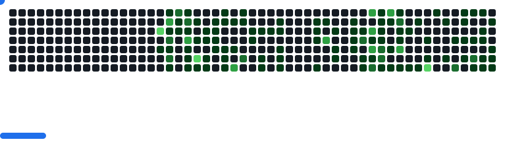

# gsthong / dorime

Small rules. Complex worlds.

I build simulations to explore belief, influence, and emergent behavior.

<samp>agent-based models / belief networks / interactive systems</samp>

 

### Selected experiments

[**Belief networks**](https://github.com/gsthong/nckh_v3)  
Strategic manipulation. Network topology. The limits of consensus.

[**Layered Society**](https://github.com/gsthong/layered-society---mvp)  
An agent-based sandbox for social dynamics and adversarial influence.

[**Physics engine**](https://github.com/gsthong/Simple-Physics-Engine)  
Rigid bodies and collision detection, written in C++17.

 

<samp>off the clock / contribution arcade</samp>

<picture>
  <source media="(prefers-color-scheme: dark)" srcset="assets/breakout-dark.svg">
  <source media="(prefers-color-scheme: light)" srcset="assets/breakout-light.svg">
  
</picture>

<a href="https://github.com/gsthong?tab=repositories">All projects</a> ? Arcade powered by <a href="https://github.com/cyprieng/github-breakout">github-breakout</a>
