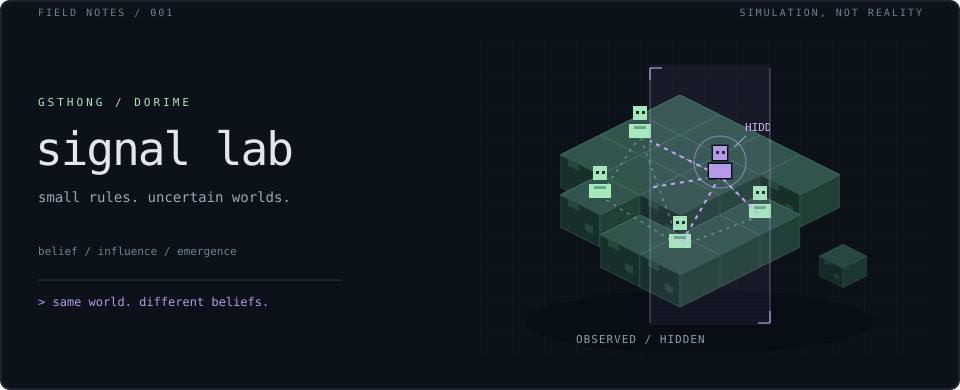

 

I build simulations to explore **belief, influence, and emergent behavior**.

$$
\underbrace{\mathbb{P}(\theta\mid m)}_{\text{updated belief}}
\propto
\underbrace{\mathbb{P}(m\mid\theta)}_{\text{a signal, not a guarantee}}
\,\mathbb{P}(\theta)
$$

 

<samp>SELECTED EXPERIMENTS /</samp>

- [**Belief networks**](https://github.com/gsthong/nckh_v3) — strategic manipulation & the limits of consensus.
- [**Layered Society**](https://github.com/gsthong/layered-society---mvp) — social dynamics in an adversarial sandbox.
- [**Physics engine**](https://github.com/gsthong/Simple-Physics-Engine) — rigid bodies, collisions, C++17.

 

Local rules. Emergent worlds. Unreliable narrators. &nbsp; / &nbsp; <a href="https://github.com/gsthong?tab=repositories">Explore the lab</a>
