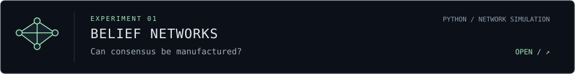

 

I build simulations to explore **belief, influence, and emergent behavior**.

$$
\text{observation}\neq\text{truth}
\qquad
P(\theta\mid m)\propto P(m\mid\theta)P(\theta)
$$

 

<samp>SELECTED EXPERIMENTS /</samp>

<samp>inspect hidden state</samp>

The scanner is a visual metaphor, not live research data. The equation above is Bayes' rule: an update depends on the assumed likelihood model, not a guarantee that a message is truthful.

- How does network topology change resilience to strategic manipulation?
- Can adaptive defenses limit polarization without suppressing useful signals?
- When do simple detection baselines outperform more complex models?

These are exploratory questions. See the linked repositories for implementations and current limitations, or open the [Layered Society research directory](https://github.com/gsthong/layered-society---mvp/tree/main/research).

 

Local rules. Emergent worlds. Unreliable narrators. &nbsp; / &nbsp; <a href="https://github.com/gsthong?tab=repositories">Explore the lab</a>
